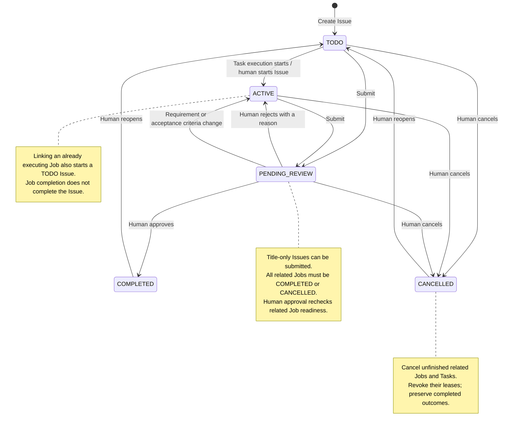
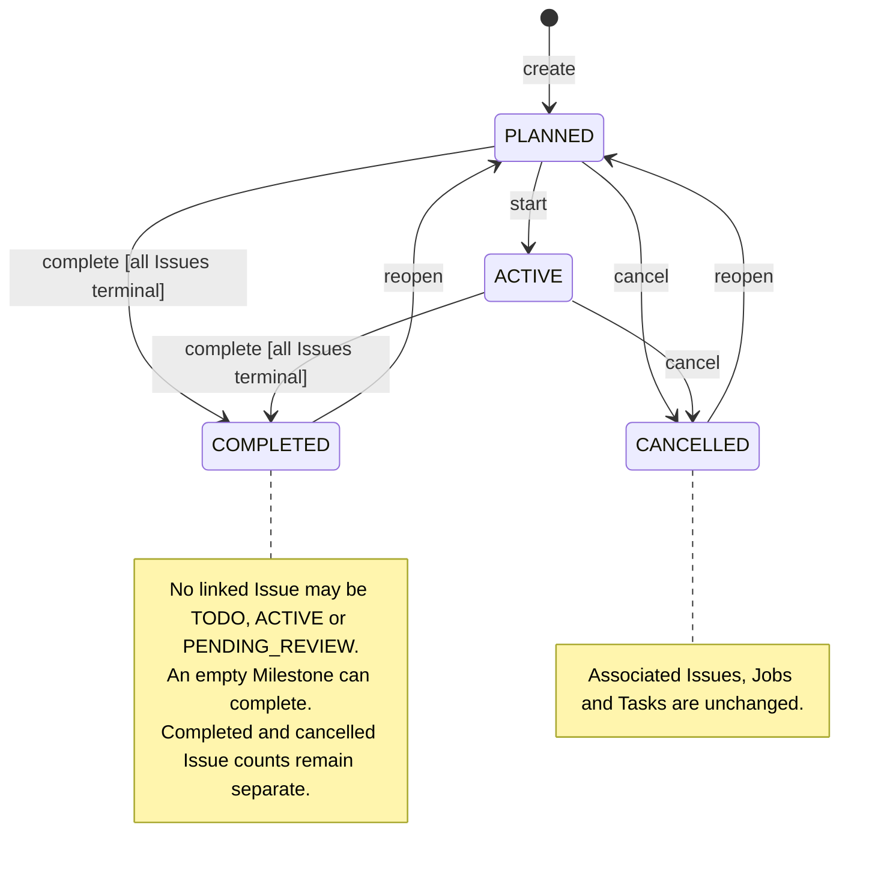
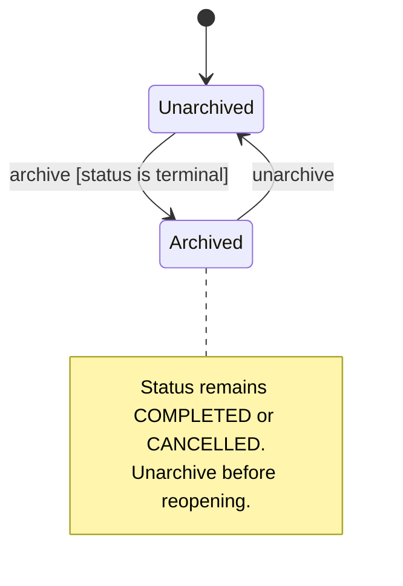

# Project Issues and Milestones

Issue is the durable project requirement. Job is one execution round; Task remains the leased unit of execution with its existing state machine. A Project contains Issues and basic Milestones. Each Issue belongs to exactly one Project and optionally one Milestone from that Project. A Job may reference one Issue or remain independent. Many Jobs may implement one Issue, including parallel rounds. There is no Issue lease or automatic queue draining.

## Persistence and mutations

SQLite stores only Issue metadata: identity, title/name, optional type, associations, status, revision, content hashes, lifecycle timestamps, and document location. Requirement, Acceptance Criteria and Notes live only in the Obsidian Markdown document; they are absent from Issue rows and persisted command replay results. `issue show` and IM detail read those sections on demand. Routing uses bounded titles and document references rather than loading prose into SQLite. Milestones store a title/name, goal, order, optional due date, lifecycle status/timestamps, independent archive timestamp, revision, and Project identity. Job `issue_id` is nullable. Indexed queries apply Project, status, Milestone, archive and association predicates before paging; IM pages contain six entries. Routing summaries expose at most 32 TODO/ACTIVE Issue candidates and mark incomplete evidence explicitly. Selected Issue bodies are synchronized and read in full before association.

Association rejects cross-Project links and guards the selected Issue revision/content hash. Linking an already executing Job starts a TODO Issue; otherwise the first successful `task.start` starts it atomically with execution. Claim and Plan publication do not start the Issue. Terminal Jobs support historical association metadata without reopening execution. Reassigning/unlinking a Job never completes or resets either Issue.

Issue changes participate in the same state-difference transaction, event log and durable document publication queue as Jobs and Tasks. Cancellation uses the existing Job cancellation and memory-source invalidation path. Publication records the document body hash only after successful file writes, together with registered paths and generation-checked acknowledgements. Pending generations survive failures and restarts.

## Query and publication cost

Ordinary Issue mutations materialize only the Issue and its Project/Milestone parents. Submission and approval use a transaction-local indexed existence query for unfinished Jobs; they do not deserialize Job prompts or conversations or issue per-Job Task-count queries. Cancellation intentionally loads the affected Jobs, Tasks and leases because it changes all unfinished execution records atomically. Renaming an Issue queues linked Job documents using indexed IDs, without loading their bodies during the mutation.

IM Milestone browsing and selection use SQL pagination (six summaries), clamp stale page numbers, and batch progress counts for the selected IDs in one read transaction. Goal previews contain at most 500 Unicode characters plus an ellipsis; the full goal remains in the Milestone note and CLI detail. Count queries and deep offsets still cost work proportional to matching rows; pagination bounds application memory, not every database operation. CLI full lists and full document rebuilds intentionally remain proportional to the selected data set.

Milestone document progress comes from the same database snapshot as the document identity. Scoped publication reads aggregate counts without loading Issue bodies; full rebuilds aggregate their existing Issue snapshot once, with no per-Milestone database reads during rendering. Detail, IM page and document counts include archived Issues and distinguish completed, cancelled and remaining work. Regression tests close the database after taking snapshots and verify that later writes cannot leak into either full or scoped rendering.

A pending full rebuild imports Issue/Milestone authored edits before rendering, using the same receipt/conflict rules as normal synchronization. Conflicting edits stop publication and retain the files. The regression fixtures verify bounded hydration with 12 linked Jobs containing 1.2 MB of goals, and Milestone page order/progress with large Unicode goals. These are deterministic allocation-bound checks, not production latency benchmarks.

## Issue lifecycle



Archival is a separate property, not another lifecycle state. Only COMPLETED or CANCELLED Issues can be archived; unarchive before reopening an archived Issue. Reopening preserves Job history and returns the Issue to TODO.

| State | Meaning | Transition |
| --- | --- | --- |
| TODO | Requirement recorded; execution has not started | First successful Task start or explicit human activation → ACTIVE |
| ACTIVE | Implementation or verification remains | Explicit submit → PENDING_REVIEW |
| PENDING_REVIEW | User acceptance requested | Human approve → COMPLETED; reasoned rejection → ACTIVE |
| COMPLETED | User accepted the requirement | Explicit reopen → TODO |
| CANCELLED | Requirement stopped; unfinished associated work cancelled | Explicit reopen → TODO |

TODO may also be submitted directly for an Issue implemented outside Taskix. Submission requires every associated Job to be COMPLETED or CANCELLED. A title-only Issue is valid. Approval rechecks related Job readiness; status transitions do not inspect authored prose. A PENDING_REVIEW Job is unfinished and blocks Issue submission. Successful Job delivery, approval, rejection, interruption and lease expiry do not automatically change Issue acceptance state. Empty-Job Issues can be accepted after the same explicit submission and human verification.

Explicit synchronization or CLI content updates that change Requirement or Acceptance Criteria while PENDING_REVIEW return the Issue to ACTIVE and invalidate the review request. Status changes themselves do not perform content synchronization. COMPLETED and CANCELLED Issues reject changes to Requirement, Acceptance Criteria and Notes until explicitly reopened. Reopen before editing a terminal note.

Human approval requires a `user:` actor. Agent execution cannot self-approve an Issue. Cancellation retains completed Task outcomes, revokes unfinished work's leases and preserves history. Reopening keeps prior Jobs and results; it does not rerun Tasks. Only terminal Issues can be archived. Project archival requires closed Jobs and terminal Issues. Milestone deletion requires explicitly unlinking its Issues first. Progress counts accepted Issues, total Issues and cancelled Issues separately; Milestones have no automatic status or scheduling/dependency engine.

## Milestone lifecycle



| Command (`taskix milestone ...`) | From | To | Preconditions / effect |
| --- | --- | --- | --- |
| `create` | No Milestone | PLANNED | Project is not archived; a title is required. |
| `start ID` | PLANNED | ACTIVE | Sets `started_at`. |
| `complete ID` | PLANNED or ACTIVE | COMPLETED | Every linked Issue is COMPLETED or CANCELLED; sets `completed_at`. |
| `cancel ID` | PLANNED or ACTIVE | CANCELLED | Sets `cancelled_at`; no cascade to linked work. |
| `reopen ID` | COMPLETED or CANCELLED | PLANNED | Clears `started_at`, `completed_at` and `cancelled_at`; preserves Issue associations and history. |
| `archive ID` | COMPLETED or CANCELLED, unarchived | Same status, archived | Sets `archived_at`; moves the note into `Milestones/Archived/`. |
| `unarchive ID` | COMPLETED or CANCELLED, archived | Same status, unarchived | Clears `archived_at`; restores the note under `Milestones/`. |

The Project must be unarchived for these commands. Except for `unarchive`, the
Milestone must also be unarchived. Use `--expect-revision REVISION` to reject stale
writes; Obsidian status edits supply this guard automatically. Creation initializes revision 1; each subsequent
successful mutation increments the revision and updates `updated_at`.

Only the lifecycle arrows above are supported: ACTIVE cannot move directly back
to PLANNED, and a terminal Milestone cannot move directly to ACTIVE or to the other
terminal state. Reopen first, then start, complete or cancel as appropriate.
Repeating a transition against its target state is rejected; replaying the same
idempotency key returns its original result. There is no PENDING_REVIEW state.

Archival is an independent dimension, not a fifth status:



Completion validates linked Issues at that moment. Subsequent Issue creation,
reassignment or reopening does not automatically change the Milestone's status.
Issue progress never starts or completes a Milestone automatically. Deletion is
separate from lifecycle transitions: unlink or reassign all Issues before deleting
an unarchived Milestone.

Completion uses an indexed SQL existence query in the same write transaction,
without loading every linked Issue into memory. Linked Issue notes refresh their
Milestone links after archive/unarchive. The Obsidian plugin submits status edits
through the same CLI and restores rejected changes. No scheduling, dependency
engine or automatic advancement is introduced.

Schema 25 fills existing Milestones with PLANNED and queues a document rebuild.
Upgrade Agentix and Taskix together; older binaries reject the new schema, and
SQLite triggers reject already-connected legacy writers that omit the status.
Synchronization renames the registered legacy `Milestones.base` to `Milestone.base`,
preserving saved views and updating the generated Board embed.

New `Milestone.base` tables default to PLANNED or ACTIVE within their Project and
include both the Milestones table and a Milestone board grouped by status. The board
orders columns as PLANNED, ACTIVE, COMPLETED, CANCELLED and shows due dates and Issue
counts. Its four status columns remain visible, including empty columns, and its
contents are not restricted by the table's open-stage filter. Dragging uses the
same lifecycle validation as CLI commands. The old default global status filter
moves to table views during synchronization. Existing registered Bases gain the status
board without replacing customized tables, filters or existing status boards.
Existing default tables without that column gain it and
the new filter; customized filters are preserved. Later filter edits survive sync.
CLI lists and IM browsing retain all statuses, including terminal stages.

## Documents and shared Bases

Issue, Job, Task, Memory and Milestone properties retain the immutable `project_id` for Project membership and add a managed `project` wikilink, for example `[[11-Agents/Projects/agentix/Board|agentix]]`. The link displays the Project name and opens its Board; editing it does not reassign the entity. Synchronization derives it from the current Project name and Board location, including renamed and archived Projects. The former `projects` list remains removed. Built-in Base Project columns and grouping use `project`, while stable-ID filters continue to use `project_id`. Existing registered Bases migrate their display columns without changing saved filters. Recent Jobs preserves saved views during incremental and full synchronization. Run `taskix sync` after upgrading to refresh existing task documents and Base columns; the memory service refreshes its notes during its bounded full projection pass, or explicitly run `taskix memory sync --project PROJECT_ID`.

Task Properties use a filename-only Job wikilink, such as `job: "[[261010-0003-Issue 项目管理]]"`. The stable `job_id` retains the association. Run `taskix sync` after upgrading to shorten existing links; Job renames refresh the filename automatically.

The root `Issue.base`, beside `Dashboard.base`, aggregates generated Issue notes across all Projects. It provides **Issues** (table), **By status** (Kanban), **By project** (grouped table), and **Archived** views. The first three exclude archived Issues and Projects. Use the native Bases filter menu to combine **Project**, **Status**, and **Milestone** filters; Project links show names; `project_id` remains available for stable-ID filters. There is no item limit. Saved filters and views survive both incremental and full synchronization, even when Obsidian removes the generated comment. Run `taskix sync` after upgrading to create the missing root Base. An unrelated existing `Issue.base` is preserved and reported as a conflict.

Each Project creates these directories and files:

```text
Projects/<project>/
  Board.md
  Issue.base
  Milestone.base
  Issues/YYMMDD-seq-name.md
  Milestones/YYMMDD-seq-name.md
  Jobs/...
  Tasks/...
```

Issue documents use a single fixed template: Requirement, Acceptance Criteria, Notes, and Related Jobs. The three editable text sections have protected start/end markers. Managed frontmatter includes stable ID, Project/Milestone identity, status, revision and lifecycle dates. Synchronization updates content hashes using registered identities; authored prose stays in the vault. Malformed or duplicated markers reject explicit content synchronization, but do not prevent status changes. Metadata publication preserves the existing document body. Deleting a note does not cancel its Issue. Copied notes are never accepted as an alternative identity. Pending publication retries (`taskix sync --pending`) check registered Issue and Milestone notes before writing; conflicting authored edits remain untouched and the publication stays queued. Resolve the conflict against the committed content before retrying. Revision-guarded content updates never silently rebase over synchronized edits; reread the current revision and content before retrying. Status transitions use metadata revision guards and related Job checks without validating the prose.

There is one shared `Issue.base` per Project. Its global filter selects the Project. Its Issue board, By Milestone and Pending review views select Issue notes. The Related Jobs view selects active and archived Job notes using `issue_id == this.id`, and requires the embedding note to be an Issue. Each Issue embeds that view. The Milestone Issues view uses `milestone_id == this.id` for the embedding Milestone. No separate per-Issue Job Base is generated.

Taskix Sync offers **New Issue** only on the registered active Project's exact `Issues/` directory. The modal asks for a title and optional Milestone, invokes the same CLI creation template, and opens the generated document after metadata caching catches up. Archived, copied and nested directories do not qualify. Saved requirement/acceptance/notes edits refresh metadata hashes after five idle seconds without storing prose; pending paths survive plugin reload. See [Obsidian editing synchronization](obsidian-edit-sync.md) for recovery and notification behavior. Status/Milestone edits use revision guards and restore rejected managed properties while preserving authored content. Generated revision changes suppress publication echoes. Existing Task status semantics are unchanged.

Right-click the registered active Project's `Milestones/` directory and choose **New Milestone**. Enter a title and an optional goal, then select **Create Milestone**. Taskix Sync uses `milestone create` and the same fixed template as CLI creation: managed identity/progress properties, an editable Goal section and an embedded Issues view. The generated file opens after publication; retries use an idempotency key and publication conflicts display a recovery notice. Copied, archived, or nested directories cannot create a Milestone through this menu.

To associate an existing Job in Obsidian, open its Properties and set `issue` to one Issue wikilink, for example `[[11-Agents/Projects/Demo/Issues/261010-0001-Login]]` (use your configured vault path). Clearing `issue` removes the association. Taskix Sync resolves the actual linked file, verifies its registered ID, path and Project, then submits a revision-guarded `job update`. The generated `issue_id` follows automatically; do not edit it separately. Invalid, copied, foreign or stale links are rejected and the authoritative association is restored. Issue renames update linked Job notes. Existing Job/Issue lifecycle rules still apply, and association never accepts an Issue.

Migration also handles renamed Project folders and archive relocation before persisting changed Issue paths. A changed legacy requirement or acceptance invalidates PENDING_REVIEW and advances the Issue revision. For COMPLETED/CANCELLED Issues, migration retains the last accepted hashes and preserves the differing vault note plus the legacy Markdown backup; explicit content synchronization continues to require reopening the Issue. Migration does not silently accept terminal offline edits. Public mutation requests cannot supply `content_hash` or `review_content_hash`; only vault-aware reconciliation derives them. Rename publication retries can recover the new destination only after verifying its generated identity.

## Routing and IM

An owned Job's associated Issue takes priority. An explicit Issue/Job selected through IM takes priority over model suggestions. Otherwise Jev can select one same-Project TODO/ACTIVE Issue using bounded summaries. Ambiguity, missing evidence, conflicts or service failure return the decision to the main Agent, which reads full details. No match produces an independent Job. Before linking, the selected document is synchronized, the full requirement/acceptance and Milestone context are read, and revision/hash guards are applied. Neither Jev nor hooks create Jobs or start Tasks on their own.

`/issues [STATUS] [--milestone ID]` defaults to ALL and accepts the five case-insensitive Issue states. `/issue new --title "Title" [description]` requires an explicit nonblank title and stores the optional description separately as the requirement. Quote titles containing spaces with single or double quotes. Missing, empty, whitespace-only, unclosed quoted, or duplicate title options are rejected before Project selection or creation. `/issue ID` displays details, lifecycle controls and paginated related Jobs. `/milestones` shows the current Project's Milestones and progress. Without an attached Project, commands show a Project picker. Browse/edit/acceptance works without an agent session and on read-only attachments.

Start/Continue/New round requires a writable same-Project session. The workflow can select an existing session, use the adapter's existing new-session capability, or create a workspace through the existing backend/directory picker. Selection is rechecked against fresh session workspace metadata. An owned Task on another Job prevents starting a different round. Continuing prioritizes the owned Job; multiple other active rounds require explicit selection. Attached-session completion resumes only the expected attachment epoch.

Execution dispatch includes explicit Issue and, for continuation, Job provenance, the title and the Obsidian document location. The agent reads `issue show` for requirement and acceptance context; dispatch does not copy the body into the Job prompt. Pending edits/execution are bounded and guarded by owner, conversation generation, attachment epoch and entity revision. Foreign replies cannot consume another owner's pending edit. `/cancel`, stale controls and duplicate callbacks are fenced. Job delivery notices identify its Issue and offer another round while leaving the Issue ACTIVE. Issue review notices are scoped to the submitting conversation, without Project-wide fanout. Feishu, Telegram and Slack render the same opaque scoped controls through their existing adapters.

Issue edit/rejection replies share one conversation reply mode with directory selection, Task reasons, session rename and interaction text replies. Starting one replaces the previous mode. Issue submission notifies its bound conversation with acceptance controls. Deleted historical Issues do not block Job notification delivery; cancellation notices prioritize the newest cancellations within the bounded session result.

## Upgrade and acceptance boundaries

### Issue content storage (schema 24, unreleased)

Upgrade Taskix and Agentix together, then run `taskix sync`. SQLite no longer stores the `requirement`, `acceptance` or `notes` keys in Issue records. These sections live only in Obsidian; keep the matching vault in backups. `taskix issue show ID` reads the current document, while list/routing results contain metadata and document references. Content flags on `issue create/update` still work and write the vault directly using a durable file journal; successful publication removes the journal.

Migration exports missing notes before removing legacy JSON keys and strips authored fields from historical Issue replay results. If a note differs from the database version, the note is preserved and the old database content is saved under `Issue Migration/<issue-id>.md` in the configured task document directory. Failed exports leave the database content intact for retry. Schema constraints reject older writers that attempt to reintroduce the fields. Changes do not affect Milestone goal or Job/Task storage.

Schema 23 removes Inbox storage and runtime support completely; old commands, Job association flags, status aliases, source polling, parsers and menus are unavailable. There is no conversion to Issues or compatibility layer. Stop all old Taskix/Agentix writers and back up SQLite plus the matching document tree before upgrading the CLI, service and host/desktop plugins together.

The one-time migration drops the old entity table and its indices, retires entity-specific receipts/events and queues a full document rebuild. Old registered document paths remain registered until successful cleanup, including archived paths. Earlier initialization-only receipts become one-time cleanup candidates; their files must retain matching generated Project identity before removal. Cleanup uses the normal vault path validation and durable generation acknowledgement. Failure remains retryable with `sync --pending`; unregistered same-name user files are preserved. Jobs, Tasks, Plans, their execution audit and original conversations remain intact, including Job events triggered by the old intake. No live database is upgraded during development acceptance.

Reusable tests cover domain lifecycle and associations, SQL paging, body imports, template and shared Base definitions, routing guards, all four host integrations, IM owner/epoch/cancellation and execution workflows, and schema upgrade cleanup/retry/path safety. Adapter tests use local HTTP mocks; they prove payload/control integration, not live IM delivery. Isolated Obsidian acceptance verifies actual native Base filtering, generated-note opening, body edits and human status changes. Live acceptance and unit coverage are reported separately.

## Issue type labels (schema 26, unreleased)

`issue_type` is a nullable classification independent of status: `feature`, `bug`,
`enhancement`, `documentation`, `question`, or `refactor`. Existing records without the
field remain unclassified; no label is inferred. Invalid values are rejected.
Type changes use the normal Issue revision guard and require reopening terminal
Issues. Type metadata is projected into Issue frontmatter and new Base views.
Existing customized Base layouts are preserved; add `issue_type` as a visible
property there if desired.

The Obsidian New Issue dialog provides an optional **Type** dropdown. CLI creation
and updates accept `--type bug`; `issue update ID --clear-type` removes the label.
IM accepts `/issue new --title "Login fails" --type bug Details`; title and type
options can appear in either order before the optional description. The title
is required even when a type is supplied; the old description-only form is rejected.
Issue details display the type and
provide a **Type** button with the same choices and **None** to clear it. These
controls retain the existing owner, conversation and revision guards.

Upgrade Agentix, Taskix and the Obsidian plugin together. Schema 26 preserves
legacy rows and prevents already-connected older writers from dropping an
existing type field. No live database is upgraded by the regression tests.
