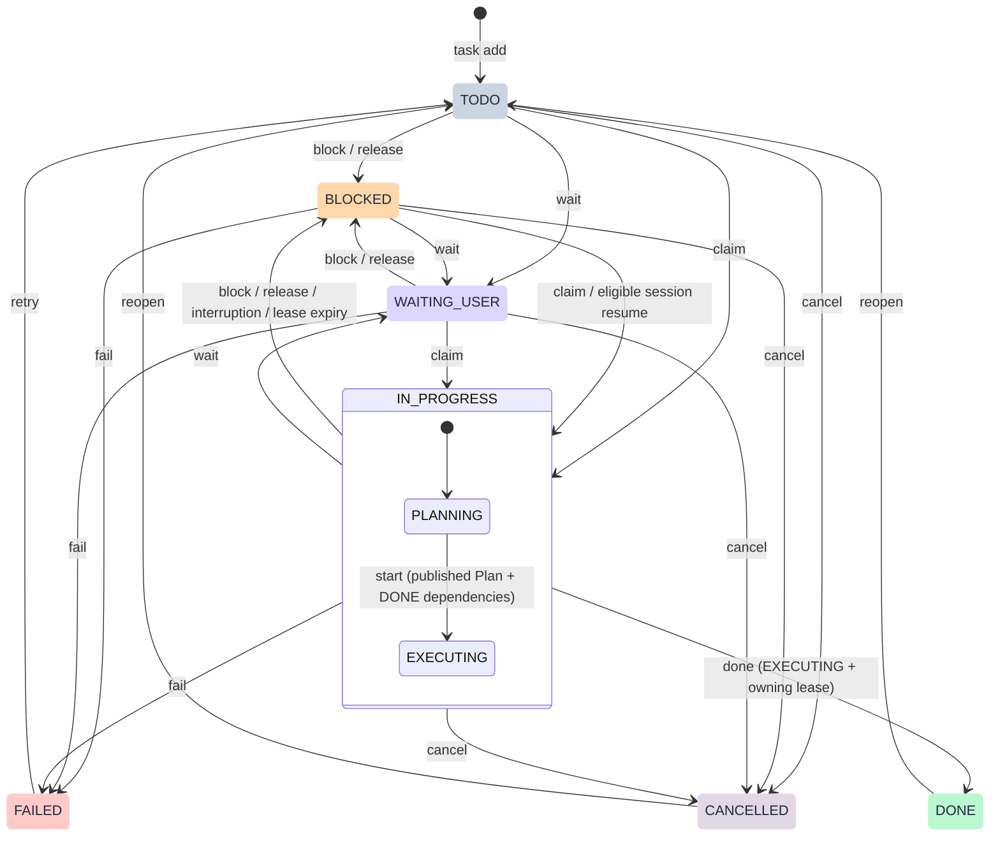
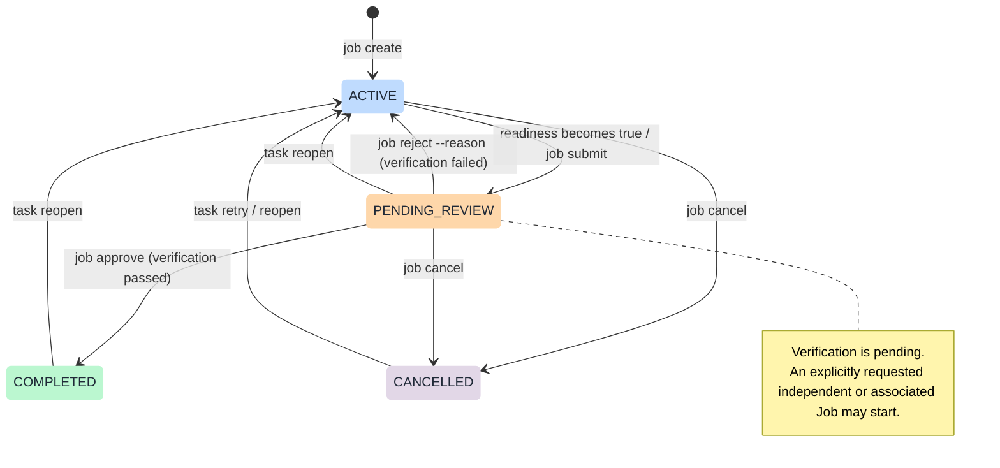
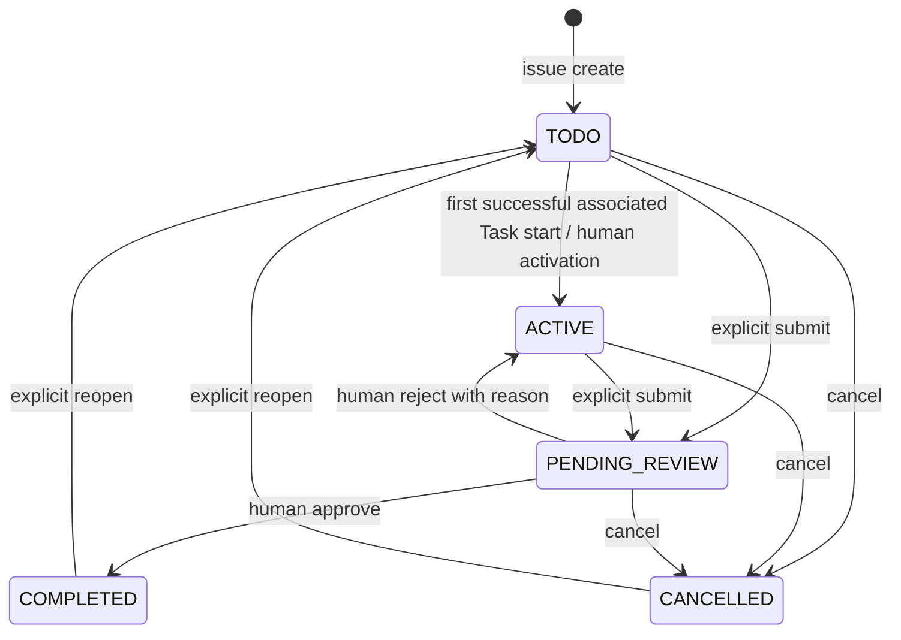

# Task, Job and Issue state machines

SQLite enforces these transitions. The desktop Taskix Sync plugin submits saved Obsidian `status` edits through the same CLI; a rejected edit is restored and produces a notification. See [Obsidian setup and supported edits](https://github.com/tenfyzhong/agentix/wiki/Obsidian#status-edits).

## Task

Claim creates a fresh lease and always enters PLANNING. Plan creation/revision and heartbeat preserve the phase; start retains the lease. Leaving IN_PROGRESS clears its phase and lease. Session resumption only reclaims eligible system-blocked work. Retry/reopen require an unarchived Job; reopening a prerequisite is rejected if a dependent has already started execution. Job cancellation also cancels unfinished Tasks after their leases have been released, while preserving DONE/FAILED/CANCELLED outcomes. These guards apply in addition to the arrows.

## Job

Readiness means at least one non-CANCELLED Task exists and every such Task is DONE. Only a false-to-true readiness transition submits automatically. Cancelling every Task never counts as delivery. A rejection records `review_reason` and preserves every Task's status; metadata edits, heartbeats, and sync do not resubmit it. Reopen a Task or add repair work to make changes, then finish that work, or explicitly use `job submit` after rechecking unchanged deliverables.

`pending_review_at` records the most recent transition into PENDING_REVIEW, including automatic readiness and explicit resubmission. Metadata edits, rejection, and approval preserve it; the Dashboard Pending review view sorts pending Jobs oldest first by this field; Recent Jobs sorts all statuses by latest update. Job document timestamps use the computer’s local time zone.

Approval alone sets `completed_at` and emits `job.completed`. Submission emits `job.pending_review`; rejection emits `job.rejected`. Resubmission and approval clear the current review reason; events retain the history. The CLI checks state and readiness, while the reviewer is responsible for performing acceptance checks. Agents must not approve their own delivery unless the user explicitly authorizes them to perform that verification.

PENDING_REVIEW is unfinished: it cannot be archived and blocks Project archival and submission of its associated Issue. Job approval and readiness never complete an Issue. COMPLETED and CANCELLED Jobs may be archived/unarchived; archival is an independent property. Historical COMPLETED Jobs remain completed after upgrades.

## Issue

Submission and approval require every associated Job to be COMPLETED or CANCELLED. Requirement, Acceptance Criteria and Notes are optional; a title-only Issue can be submitted. Status transitions do not inspect authored prose. Approval rechecks readiness and requires a human actor. Zero-Job Issues can follow the same offline acceptance workflow. A Job ending never completes or resets its Issue. Cancellation revokes unfinished Jobs/Tasks and their leases while preserving delivered outcomes. Reopening preserves history. There is no Issue lease; several Jobs can implement one Issue. The Task state machine above remains unchanged. See [Project Issue design](project-issues.md).
